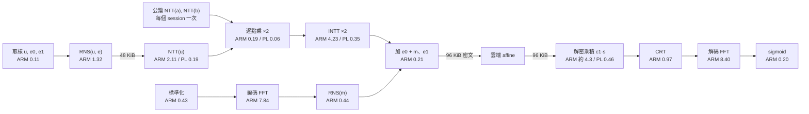

# 教授回饋深度分析：研究基準點、可重用模組、切分方法與重新定位

2026-10-18。回應 2026-10-15 指導教授的四點回饋。依據：網路文獻搜尋（156 篇，全部逐篇查證，連結見[參考文獻總表](2026-10-18_references.md)）、以 2026-10-14 KV260 實測校準的切分模型 v0.1（[partition_model_v0.1](partition_model_v0.1/PARTITION_MODEL.md)），以及 repo 內的量測（[COMPARISON](COMPARISON.md)）。

數字標記：**【實測】**我們在 KV260 上量到；**【文獻】**論文報告的數字；**【推導】**由實測或文獻計算而來（附算式）；**【估計】**假設或外推，必須實測確認。

## 目錄

0. [一頁結論](#0-一頁結論)
1. [四點回饋換成研究方法的語言](#1-四點回饋換成研究方法的語言)
2. [回饋 1：研究基準點](#2-回饋-1研究基準點)
3. [回饋 2：重用已驗證的模組](#3-回饋-2重用已驗證的模組)
4. [回饋 3：切分要有分析過程](#4-回饋-3切分要有分析過程)
5. [回饋 4：定位——有沒有人做一樣的事](#5-回饋-4定位有沒有人做一樣的事)
6. [重新訂定方向：路線圖](#6-重新訂定方向路線圖)
7. [本次分析的限制](#7-本次分析的限制)

## 0. 一頁結論

1. **研究基準點**是外部、已驗證、做同一件事（最好同平台、同參數、同安全等級）的結果，不是我們自己的序列版。我們需要一個「基準點階梯」（第 2.2 節）：同一塊板上的最佳軟體（SEAL-Embedded、SEAL、OpenFHE 在 A53 上）、同板的對手（Guerrini et al., DATE 2026，KV260）、FPGA client 加速器（Aloha-HE, DATE 2024；CAEA, TCAS-II 2025）、同晶片家族的 ARM+FPGA 系統（Sinha Roy et al., HPCA 2019），以及同一顆 A53 上的格密碼軟硬體協同設計（GMU, FPL 2019、ICFPT 2019）。
2. **教授的擔心有數據支持：我們的序列基準偏弱。**
   - ARM NTT 約 34 cycles/butterfly【推導】；文獻的 NEON 實作是 1.7–2.2【文獻，A55/A72，n=256】。
   - `residues()` 用 64-bit `%` 轉 RNS，每批花約 7 ms【推導】。
   - 編碼每個特徵 7.8 ms【實測】，比 SEAL-Embedded 在更弱的 Cortex-A7 上的 IFFT 多約 3 倍週期數。
   - 在 x86 上 OpenFHE 的 client hot path 比我們快 1.6 倍【實測】。
3. **FPGA 核心本身不差，差在系統整合與面積效率。** 每個 limb 的 NTT 是 6,180 cycles，理論下界是 6,144【實測，HLS】。但我們只跑 100 MHz，每次 limb-NTT 的 DSP·µs 是文獻的 6–13 倍【推導】。每次呼叫要 4.7 ms，真正的 DMA＋PL 只占 0.54 ms【實測】。
4. **「用 ARM＋FPGA 加速 client 端 CKKS」已經有人做，不能當主要貢獻。**
   - Guerrini et al.（DATE 2026）在同一塊 KV260 上把 NTT 接進 HEAAN，宣稱 encode 快 4.47 倍、encrypt 快 3.63 倍。這兩個數字只來自摘要，全文還沒讀到。
   - Aloha-HE 把整條 client 流程（含 FFT）放進 FPGA，而且開源。
5. **文獻中仍是空白、而我們有實測基礎可以主張的（第 5.3 節）：**
   - (a) 以實測校準的節點圖求出可證明最佳的 ARM/PL 切分，並報告模型的預測誤差；
   - (b) Linux 驅動與快取一致性層級的資料搬移剖析；
   - (c) 多核 ARM 與 PL 共同排程的批次管線，用 records/s 和 records/J 評估；
   - (d) 演算法層選擇（公鑰常駐、對稱加密、離線預算）與 HHE 之間的交叉點分析。
6. **切分模型 v0.1（已校準，各步驟誤差 ≤1.8%）告訴我們先後順序：**
   - 現行驅動下，最佳解是全部留在 ARM。
   - 照現行程式結構，就算乘法完全不花時間，延遲也只能快 1.44 倍。
   - 驅動修好後，PL 主要贏在吞吐量（約 1.5 倍）。
   - 如果 ARM 的 NTT 快 3 倍，PL 的延遲優勢幾乎消失。

   所以順序是：先公平化（標準參數、最佳軟體基準、修驅動），再量節點、求解，最後才實作。
7. **安全參數要先換，代價很小。** N=4096、logQ≈88.6 本來就在 128-bit 的模數上限內：HE Standard 是 109，Bossuat et al. 2025 是 106【文獻】。只要把自訂的稀疏取樣換成標準分佈（uniform ternary 加 σ≈3.2 的 Gaussian 或 CBD），就能跟所有基準在同一條件下比較。

## 1. 四點回饋換成研究方法的語言

| 回饋 | 對應的研究方法要求 | 我們目前的缺口 |
|---|---|---|
| 1 研究基準點 | 跟外部、已驗證、同任務的結果比；報絕對值加上正規化指標；照 Hoefler & Belli（SC 2015）的規則，基準要給絕對效能、要給上界 | 只跟自己的 `cpu-w1` 比；自己的序列版不是最佳實作 |
| 2 站在前人肩上 | 重用已驗證的函式庫、IP、驅動，把貢獻放在系統層；讓橫向比較成為可能 | 數學、取樣、FFT、NTT、驅動、HLS 全部自寫，沒有任何外部對照組 |
| 3 切分要有依據 | 學術名稱是 **Hardware/Software Partitioning**：拆成任務圖、量測、建成本模型、求解、驗證（第 4 節） | 分工憑直覺。例如「PRNG 從 PL 搬回 PS」沒有做過任何 A/B 比較 |
| 4 定位 | 相關研究比較表、差異化、貢獻宣稱 | 提案的文獻回顧只有 3 篇，而且其中一篇查無此題（第 7 節） |

## 2. 回饋 1：研究基準點

### 2.1 什麼才算研究基準點

研究基準點（research baseline）是用來衡量我們結果的外部參考點，要滿足三個條件：

1. **做同一件事**：同任務、同參數（或可以換算）、同安全等級。參數不同就要正規化，安全等級不同就不能比。
2. **分三層報告**：只加速的部分（kernel）、含傳輸的單次呼叫、端到端。文獻一再顯示這三層的倍數差很多：
   - Di Matteo et al.（IEEE Access 2023）：kernel 約 1000 倍，整體只有約 20 倍【文獻】。
   - GMU（FPL 2019）：多項式乘法本身 89 倍，加上 DMA 的整次呼叫約 14 倍，整個加密 2.4–3.9 倍【文獻】。
3. **跟最佳可得的實作比，不是跟自己比。**
   - F1（MICRO 2021）批評 HEAX 的 200 倍只是相對單核 CPU。
   - Hoefler & Belli 統計 39 篇報告加速比的論文，38% 沒有給基準的絕對效能【文獻】。

教授說「平行別人可以做到 10 倍」，這要配合基準一起看：
- 相對**弱基準**時，文獻常見 10–1000 倍：RISC-V 軟核約 1000 倍、單執行緒 x86 13 倍。
- 相對**同一顆晶片上的最佳軟體**時，格密碼端到端常見 2–4 倍，KEM 可到 7–28 倍。

我們該設定的目標是後者。

### 2.2 基準點階梯

| 層級 | 基準 | 平台與參數 | 文獻數字 | 拿來比我們的什麼 |
|---|---|---|---|---|
| L0 同板最佳軟體（要自己在 KV260 上跑） | **SEAL-Embedded**（TCHES 2021） | Cortex-A7 @494 MHz；N=4096、3 個 ≤30-bit 質數、2048 個值、128-bit | 非對稱 encode+encrypt 76.8 ms（約 38M cycles）；對稱 60.0 ms；NTT 3.22 ms/質數；IFFT 6.0–7.5 ms | 參數和我們幾乎完全相同，是 ARM 端整體的首要基準 |
| L0 | **Microsoft SEAL 4.x、OpenFHE 1.5.1**（1 與 4 執行緒） | 在 KV260 的 A53 上原生編譯 | 文獻沒有 A53 數據，要自己量；x86 上 OpenFHE 7.8 ms vs 我們 12.6 ms【實測】 | 函式庫等級的基準 |
| L0 | **Neon NTT**（TCHES 2022）、**SLOTHY**（TCHES 2024） | A72 / A55，n=256 | 1.7–2.2 cycles/butterfly | ARM NTT kernel 的天花板（要移植到 30-bit、N=4096 後在 A53 上量） |
| L1 同板對手 | **Guerrini et al.**（DATE 2026） | KV260＋full-RNS HEAAN，logN 12–16 | encode 4.47×、encrypt 3.63×（僅摘要；基準與是否含 DMA 未知） | 同平台、同任務，必須正面比較 |
| L2 FPGA client 加速器 | **Aloha-HE**（DATE 2024，MIT 開源） | Kintex-7 200 MHz；N=8192、3×54-bit | encode+encrypt 2.14 ms、decrypt+decode 1.14 ms；17.7k LUT、56 DSP（轉引自 DNA-HHE 的比較表） | 整條 client 流程上硬體的做法；面積效率 |
| L2 | **CAEA**（TCAS-II 2025） | Kintex-7 / Zynq US+ | 1.78 ms / 0.42 ms；10.8k LUT、60 DSP（轉引） | client 加速器的現行最佳 |
| L2 | **RISE**（TVLSI 2023）、**CHOCO-TACO**（ASPLOS 2022） | RISC-V SoC（12 nm）、45 nm ASIC 模型 | RISE 有 N=4096、3×30-bit 的節點時間分解；CHOCO 證明只加速 NTT 不夠 | 「逐節點卸載＋Amdahl」的方法範例 |
| L3 同晶片家族的 ARM+FPGA 系統 | **Sinha Roy et al.**（HPCA 2019，原始碼 HEAT） | ZCU102；N=4096、6×30-bit，200 MHz | 98 KB DMA 76 µs（約 1.29 GB/s）；改成 1 KiB 分塊慢 2.66×；NTT 73 µs；含通訊 400 Mult/s | PS↔PL 傳輸成本、每次呼叫的固定開銷 |
| L3 | **Steeg et al.**（HEART 2026，開源） | ZCU102；N=4096、30-bit | P4 @270 MHz，每個 residue 36.6 µs、224 DSP | 同參數的 FPGA 乘法基準 |
| L4 NTT 核心 | **NTTGen**（CF 2022）、**Mert et al.**（IEEE TC 2022）、**OpenNTT**（ICCAD 2024） | UltraScale+ / Virtex-7 | NTTGen：N=4096、6×30-bit，24.7 µs @250 MHz、288 DSP；Mert：(4096, 60) 8 PE 26.2 µs、248 DSP | 核心的 cycles、時脈、DSP 效率 |
| L5 同一顆 A53 的格密碼協同設計 | **GMU**：FPL 2019、ICFPT 2019、PQCrypto 2019 | ZCU102 的 A53 @1.2 GHz，bare-metal，AXI DMA | 多項式乘法呼叫 20.1 µs（DMA 10.2、PL 3.1）；整個加密 2.4–3.9×；KEM 封裝 7.1–28.4×；傳輸占呼叫的 78–89% | 方法與報告格式（先 profiling、再卸載、分層報告）；端到端倍數的合理範圍 |

### 2.3 我們現在站在哪裡

| 指標 | 我們 | 基準 | 判讀 |
|---|---|---|---|
| ARM NTT（cycles/butterfly） | 約 34【推導：1.85 ms × 1.333 GHz ÷ (3 × 24,576)】 | Neon NTT（A72）2.2、SLOTHY（A55）1.7【文獻，n=256】；SEAL-Embedded（A7）約 65【推導】 | 介於「記憶體導向的 IoT 函式庫」與「向量化 SOTA」之間。外推 A53 NEON 的 3-limb NTT 約 0.1–0.4 ms【估計】，我們是 1.85 ms |
| 編碼（2048 值） | 7.85 ms，約 10.5M cycles【實測】 | SEAL-Embedded 在 A7 上的 IFFT 6.0–7.5 ms，約 3–3.7M cycles【文獻】 | 週期數多約 3 倍。原因是逐係數 `std::pow`、複數除法、用大小 N 的通用 FFT；函式庫做的是 N/2 的專用 FFT 加預算根表 |
| client hot path（x86） | 12.6 ms【實測】 | OpenFHE 7.8 ms【實測】 | 自寫版較慢 1.6 倍 |
| 每個 ciphertext 的加密（攤提） | 4 核 ARM 約 6.1 ms，N=4096【推導：(8.3 + 16.2) ÷ 4】 | Aloha-HE 2.14 ms，N=8192、3×54-bit（工作量約 2 倍以上），56 DSP【文獻轉引】 | 硬體 client 加速器在更大的參數下仍快約 3 倍 |
| FPGA NTT 核心 | 6,180 cycles/limb @100 MHz，3 limbs 共 61.8 µs【實測】 | NTTGen 24.7 µs（6 limbs）；HPCA'19 73 µs（6 limbs） | cycles 接近下界；但時脈只有一半到四成 |
| DSP 效率（每次 limb-NTT 的 DSP·µs） | 約 15.4k【推導：753 DSP × 61.8 µs ÷ 3；把全部 DSP 都算進去】 | NTTGen 約 1.2k、HPCA'19 約 2.4k【推導】 | 差 6–13 倍。要查 HLS 是否把 30-bit 乘法做成 64-bit 乘法器 |
| 每次呼叫的開銷 | 4.7 ms / 192 KiB【實測】 | 以 HPCA'19 的 1.29 GB/s 換算，192 KiB 約 0.15 ms【推導】；GMU 每次呼叫 20.1 µs | 差約 30 倍，問題在驅動層 |
| 端到端相對同晶片最佳軟體 | 0.54×，FPGA 反而較慢【實測，相對我們自己的 4 核】 | GMU 2.4–3.9×；Guerrini 3.63×（摘要） | 而且我們的「最佳軟體」還不是真正的最佳 |

### 2.4 公平比較的做法

1. **同參數、同安全等級**：見第 2.5 節。
2. **完整列出條件**：函式庫版本、執行緒數、頻率、是否綁核、編譯旗標。我們的[公平規則](COMPARISON.md#公平規則--fairness-rules)已經涵蓋自己的兩組，要延伸到外部基準。
3. **正規化**：
   - 跨平台用 cycles/butterfly、DSP·µs 或 LUT·µs（area-time product）、換算到同時脈的 µs、records/J；
   - 每個數字都標明是否包含 host 傳輸。
4. **三層報告，再加上理論上界**：
   - AXIS 128-bit × 100 MHz = 1.6 GB/s，64 KiB 單向約 41 µs；
   - NTT 下界是 N/2 × log₂N ÷ lanes = 6,144 cycles。
5. **多個基準同列**：單核 A53、4 核 NEON A53、SEAL-Embedded、OpenFHE/SEAL、Guerrini。不能只挑對自己有利的那一個。

### 2.5 安全參數對齊（不先做，任何比較都不成立）

- **模數已經合格**：HE Standard 2018 規定 N=4096 時 logQ ≤ 109（ternary secret、classical 128-bit）；Bossuat et al.（IACR CiC 2025）改用新的成本模型後是 106。我們是 88.6，沒有 key switching，所以不需要 special prime【文獻】。
- **問題在分佈**：目前 s 和 u 各只有 64 個非零 ±1，e 只有 16 個非零 ±1。這不在任何已分析過的範圍內：
  - HE Standard 不提供稀疏參數的表格；
  - 稀疏 secret 的安全性自評常被高估（Albrecht, EUROCRYPT 2017；Son & Cheon 2019；Cheon et al. 2019）；
  - 本次分析做過一個 Prange 式粗估（未經同儕審查），結果遠低於 128-bit；
  - 我們不做 bootstrapping，而 bootstrapping 正是 CKKS 使用稀疏 secret 的唯一理由，沒有保留的必要。
- **改法**：s 和 u 用 uniform ternary，e 用 σ≈3.19 的 discrete Gaussian 或 CBD；用 OS 亂數當 seed，再用 SHAKE 展開（SEAL-Embedded 的做法）。
- **代價**：
  - 取樣節點會變貴：SEAL-Embedded 在 A7 上每個多項式 ternary 1.75 ms、CBD 9.37 ms【文獻】，所以取樣必須放進節點圖。
  - slot 誤差估計約損失 8 bits，4 特徵 LR 的判讀仍然足夠【估計】；不夠時可以調高 scale。
  - NTT 乘法成本不變。
- **IND-CPA^D**（Li & Micciancio, EUROCRYPT 2021；Guo et al., USENIX Security 2024）：論文要寫清楚二擇一——解密值不離開 edge，或者在解密端做 noise flooding。

## 3. 回饋 2：重用已驗證的模組

原則：每個自寫模組都要有一個外部對照組；能直接用的就用，把我們的貢獻放在系統層。

| 模組 | 現在 | 建議重用或拿來對照 | 成熟度與授權 | 怎麼用 | 注意 |
|---|---|---|---|---|---|
| CKKS client 數學（encode、取樣、加解密） | `core.cpp` 自寫 | **SEAL-Embedded**（TCHES 2021）、**Microsoft SEAL 4.x**、**OpenFHE**（有 hardware abstraction layer） | 頂刊論文、MIT / BSD-2，業界維護 | 先在 A53 上當基準；再考慮直接用它們的 encoder 與 sampler | SEAL 允許自訂係數模數（只要是 ≡1 mod 2N 的質數），理論上可以直接用我們 PL 的三個質數【需實測確認】；OpenFHE 不容易指定質數 |
| 取樣、PRNG | `getrandom` 加自寫稀疏取樣 | FIPS 202 SHAKE（**mlkem-native** 的 Keccak 有 AArch64 形式化驗證）、SEAL-Embedded 的 CBD；PL 端可以用 ML-KEM 硬體的 Keccak＋CBD | NIST 標準 | 換成標準分佈；PL 端由 seed 展開（RISE、Dang ICFPT 2019 都只傳 seed） | 要 constant-time |
| 編碼與解碼的 FFT | 自寫 radix-2 加逐係數 `std::pow` | SEAL/OpenFHE 的 CKKS encoder（N/2 專用 FFT 加預算根表）、**FFTW3**（aarch64 NEON） | 成熟 | 先換掉，量到新的 ARM 成本，再判斷要不要放 PL | 放 PL 要用浮點，Aloha-HE 是自己設計浮點單元 |
| ARM NTT | 自寫 scalar Shoup | SEAL 的 Harvey NTT（scalar 基準）、**Neon NTT / SLOTHY** 的 32-bit lane Barrett/Montgomery 技術 | 頂刊、程式碼公開 | 先求 ARM 節點成本的真正下界 | 30-bit 質數放在 signed 32-bit lane 只剩約 1 bit 的 lazy reduction 空間 |
| PL NTT 與多項式乘法 | 自寫 Vitis HLS | **OpenNTT**（ICCAD 2024，MIT，N=4096 範例已在 PYNQ-Z2 上板）、**Proteus**（TVLSI 2024）、**parametric-ntt**（TC 2022）、**Aloha-HE**（整條 client）、**HEAT**（HPCA 2019 的 ZCU102 ARM+FPGA 原始碼）、**Steeg 2026**（ZCU102，N=4096、30-bit） | 開源、有論文 | 至少在 KV260 上合成一個當對照組，比 cycles、MHz、DSP、BRAM；也可以直接替換 | 多數只報 kernel，不含 host 傳輸 |
| DMA 與驅動 | V3 驅動自寫（在 uncached buffer 上逐係數驗證） | **Xilinx dma-proxy**、**u-dma-buf**、PYNQ `allocate`、Linux DMA API 的 streaming mapping；HPC port 加 `dma-coherent` | 官方範例或維護中的開源專案 | 新驅動候選；或改用 zero-copy buffer | V3 驅動凍結不改，另立候選 |
| 切分與排程 | 切分模型 v0.1 自寫 | HEFT（TPDS 2002）、StarPU（CCPE 2011）；ILP 用現成 solver | 經典方法 | 讓我們的求解結果可以跟標準演算法對照 | — |
| 評測方法 | 自訂公平規則 | Hoefler & Belli 的 12 條規則；SUPERCOP/eBACS（用來校準 A53）；PoPETs 2023 的 FHE 函式庫標準化 benchmark | 社群標準 | 讓所有數字都可以跟文獻橫向比較 | — |
| 安全估計 | 無 | lattice-estimator、Bossuat et al. 的公開腳本 | 社群標準 | 換分佈後實際算出 bit security | 要註明 estimator 的 commit 與 cost model |

## 4. 回饋 3：切分要有分析過程

學術名稱是 **Hardware/Software Partitioning**（軟硬體切分），屬於 HW/SW Co-design 的核心子問題；整個流程也可以稱為 **Design Space Exploration（設計空間探索）**。

### 4.1 方法：七個步驟

1. **拆成任務圖（task graph / DAG）**：節點是能單獨實作、單獨計時的最小單位，邊上記錄要搬的位元組數。
2. **兩邊都量（profiling）**：
   - ARM：1 核與 4 核都要量，而且要用最佳實作。
   - PL：量核心本身的時間（HLS cosim 或板上的 AXI timer）。還沒做的節點，用 HLS 合成報告或文獻的週期數來估，並明確標記為估計。
   - 另外要量 **ARM 被占住的時間**：ioctl 是同步呼叫，等待期間那顆核心不能做別的事。
3. **邊的成本模型**：t_call = 固定開銷 + 位元組數 × 每位元組成本 + 核心時間。
   - 做法是掃描不同的資料量，用迴歸求出固定開銷與每位元組成本（LogCA, ISCA 2017 的做法）。
   - 邊的成本取決於資料放在哪裡：資料常駐在 PL，那條邊就不存在。
4. **先校準**：模型必須先能重現已經量過的組態，才能拿來預測。
5. **依目標求最佳解**：

   | 目標 | 方法 |
   |---|---|
   | 總工作量 | Stone（1977）的雙處理器 min-cut |
   | 單批延遲（makespan） | 列舉所有指派方式，搭配 HEFT 式排程；或用 ILP。節點只有幾十個，窮舉就能得到可證明的最佳解 |
   | 吞吐量 | 由瓶頸資源決定：1 / max(T_ARM, T_PL, T_傳輸)（Bokhari 1988；Gables, HPCA 2019） |
   | 能耗 | 功率 × 各資源的忙碌時間 |

6. **上界與損益平衡點**：Amdahl 天花板，以及 LogCA 的 break-even。
7. **實作預測的最佳解並實測**，報告模型預測與實測的誤差。gem5-Aladdin 的誤差 ≤6%、StarPU 約 1%，可以當作模型誤差要做到多小的參考。

### 4.2 節點圖（每批 4 個特徵，下圖是其中一個特徵；成本為 ARM 單核 ms ／ PL 核心 ms）

節點成本的來源：
- ARM 的 NTT／INTT 每個 limb 0.70 ms，是由 backend wall time 除以轉換次數得到【推導】。
- PL 數字來自 RTL cosim 週期數【實測，模擬】，包含串流進出。
- 編碼、解碼、取樣、CRT 目前只能在 ARM 上跑。

跨 PS↔PL 的每一條邊都要付第 4.3 節的呼叫成本。完整的節點表見 [PARTITION_MODEL §2](partition_model_v0.1/PARTITION_MODEL.md#2-節點表每批)。

### 4.3 邊的成本：同一個乘積在三種驅動下

| 驅動 | 呼叫合計 ms | 其中 ARM 被占住 ms | 依據 |
|---|---|---|---|
| D0：現行 V3 驅動 | 4.93 | 4.39 | 【實測】DMA trace 逐段校準 |
| D1：可快取 buffer＋快取維護 | 1.02 | 0.47 | 【估計】團隊估計加上模型另外加的快取維護成本 |
| D2：zero-copy | 0.90 | 0.35 | 【估計】假設 |

同一個乘積在 ARM 單核上要約 6.4 ms【推導】。在 D0 下，呼叫本身就讓 ARM 忙 4.4 ms，卸載之後連 CPU 時間都省不到多少。

### 4.4 校準：模型能不能重現實測

模型照 V5 的實際寫法重建 6 種已量測的設定，對照的是 2026-10-14 KV260 的實測。

| 設定 | 加密 實測／模型 | 邊緣延遲 實測／模型 |
|---|---|---|
| cpu-w1 | 38.38 / 38.23 ms | 63.77 / 63.68 ms |
| cpu-w4 | 16.17 / 16.34 ms | 37.40 / 37.62 ms |
| fpga-serial | 47.27 / 47.36 ms | 71.26 / 71.30 ms |
| fpga-overlap | 45.98 / 45.58 ms | 69.91 / 69.52 ms |

- 各步驟誤差 ≤1.8%，邊緣延遲誤差 ≤0.6%。
- 19 批吞吐量的誤差在 −2.7% 到 +0.7%。cpu-w2 例外（−12%），因為兩個瓶頸幾乎相等，模型只取最大的那一個界限。
- 沒有拿來擬合的資料也對得上：keygen 誤差 ≤1%，V3 單獨的 NTT／INTT 呼叫誤差 +4%。

### 4.5 求解結果（預測）

基準是實測的 cpu-w4：37.40 ms，66,748 筆/秒。「同軟體 all-ARM」是在同一種排程方式下全部留在 ARM 的對照組，用來分開「軟體重構」和「PL 切分」各自的效果。

| 情境 | 驅動 | 延遲最佳切分 | 延遲 | 同軟體 all-ARM | 吞吐量 | 瓶頸 |
|---|---|---|---|---|---|---|
| S0 現況 | D0 | 全部留 ARM | 29.8 ms | 29.8 ms | 70k 筆/秒 | ARM 4 核 |
| S1 修驅動 | D1 | 混合：2 個特徵用 op2、1 個 NTT 上 PL、1 個留 ARM | 24.9 ms | 29.8 ms | 108k | ARM 4 核 |
| S3 公鑰常駐＋融合加密＋合併呼叫 | D1 | 3 個特徵上 PL、1 個留 ARM | 23.6 ms | 28.1 ms | 110k | ARM 4 核 |
| S5 同 S3，但 ARM NTT 快 3 倍 | D1 | 3 個特徵留 ARM、1 個上 PL | 21.9 ms | 22.3 ms | 110k | ARM 4 核 |
| S7 K 介面（只送 u，回傳 b·u 與 a·u） | D2 | 3 個 K＋1 個 op2/ARM 混合 | 22.3 ms | 28.1 ms | 112k | ARM 4 核 |
| W3 同 S7，且編碼／解碼快 3 倍 | D2 | 4 個 K | 8.3 ms | 15.2 ms | 274k | ARM 4 核 |

這張表的讀法：

1. **S0 輸在驅動，不在 PL**（結論穩健，只用實測與推導值）。D0 下任何 PL 指派的增益都不到 1%。
2. **Amdahl 天花板**：照現行程式結構，就算乘積和加法完全不花時間，延遲也只能從 37.4 降到 26.0 ms（1.44 倍）。原因是編碼（每批約 33 ms 的核心時間）、解碼（8.6 ms，單執行緒）和 RNS 轉換（約 7 ms）都只能在 ARM 上跑（結論穩健）。
3. **光是改軟體排程**（拿掉步驟邊界、依資料相依並行），不動 PL，延遲就會從 37.4 降到約 29.8 ms【估計，模型預測】。
4. **驅動修好後**，PL 主要贏在吞吐量（約 1.5 倍），延遲只少 15–18%，而且延遲的最佳解是 ARM 與 PL 並行的混合切分，不是全部丟給 PL。即使 D1 的每位元組成本比估計差 8 倍，吞吐量仍贏 1.31 倍。
5. **ARM 變強，PL 的延遲價值很快消失**（S5）。這就是為什麼 ARM 基準一定要用最佳實作，否則切分結論本身就不成立。
6. **Stone min-cut 指出一個比直覺更好的介面**（S7 的 K 介面）。這就是「用模型、不靠直覺」修正設計的例子。
7. **PL 能帶來多少價值，取決於先把 ARM 專屬的節點做快**（W3）。

**Break-even（LogCA 式）**：
- 在 D0 下，不管把幾個乘積合併成一次呼叫，可容忍的固定開銷都是負的。問題出在每位元組的成本，合併呼叫救不了。
- 在 D1/D2 下，可容忍的固定開銷是 0.81–4.0 ms，實際只有約 0.08 ms，固定開銷已經不是問題。
- 現行 op2 介面下，ARM 只要再快 1.12 倍，卸載在延遲上就不划算；K 介面可以撐到 1.53–1.77 倍。

### 4.6 演算法層與平行化的最佳實踐

這張表回應教授說的「先請求資料、運算時直接載入、隱藏傳輸時間」，同時列出更上游的演算法層改法。

| # | 做法 | 文獻依據 | 套到 EdgeFHE | 預期效果 |
|---|---|---|---|---|
| 1 | **公鑰以 NTT 形式常駐 PL**（URAM） | SEAL 的 `encrypt_zero_asymmetric`、SEAL-Embedded、HEAX、FAB、ARK 的 inter-operation key reuse | op2 改成 K 介面：只送 u，回傳 b·u 與 a·u | 每個密文的轉換次數從 6 降到 3，傳輸減半；模型 S7 |
| 2 | **雙緩衝與預取**（先請求資料，運算時直接載入） | Smith 的 decoupled access/execute（ISCA 1982）、Zhang et al. 的 ping-pong buffer（FPGA 2015）、HEAX 的 double/quadruple buffering、FAB 的 key prefetch、Presto（ISLPED 2026，ARM＋FPGA）以 FIFO 解耦亂數產生並 prefetch 金鑰、dma-proxy 的多 buffer 非阻塞提交 | DMA 傳第 i+1 個時 PL 算第 i 個，同時 ARM 準備第 i+2 個；ioctl 改成非同步 | 模型中 queue depth 2 可再省 0.6–1.4 ms |
| 3 | **合併呼叫**（batching） | HEAX 每個 request 至少一整個多項式、Synetgy（FPGA 2019）batch 1→16 幀率提升 1.6 倍 | 一批 8 個乘積一次呼叫 | D0 無效；修好驅動後才有效 |
| 4 | **大塊連續 DMA** | HPCA'19：改成 1 KiB 分塊慢 2.66 倍 | 合併呼叫後單次 DMA 會更大 | 降低固定開銷的占比 |
| 5 | **修驅動**：可快取 buffer 加 streaming DMA，或 HPC coherent port，或 zero-copy | Min et al. 2019（讀 uncached 記憶體最多慢 30 倍）、dma-proxy 原始碼註解、u-dma-buf、Göbel ARC 2017、Manev FPT 2019、Giri IEEE Micro 2018 | 移除在 uncached buffer 上的逐係數驗證，改在可快取的副本上驗證，或在 PL 內驗證 | 每次呼叫 4.7 → 約 1 ms【估計】 |
| 6 | **隨機多項式在 PL 由 seed 展開** | Dang ICFPT 2019（cSHAKE 放硬體，只傳 seed）、RISE、CraterLake、ARK | u 與 e 由 PL 內的 PRNG 產生 | PS→PL 幾乎只剩 m；需搭配標準取樣與 constant-time |
| 7 | **對稱加密加 seed**（edge 自己持有私鑰） | SEAL 的 seeded symmetric ciphertext；SEAL-Embedded 對稱 60.0 ms vs 非對稱 76.8 ms | c = (−a·s + m + e, seed)，a 直接在 NTT 域取樣 | 每個密文只要 1 次乘法，上傳量約減半。這是範圍決策：多個感測器共用同一把公鑰時就不適用 |
| 8 | **離線／線上拆分**：預先算好 encryption of zero | Delphi（USENIX Security 2020）；Garimella et al.（ASPLOS 2023）說明 pool 大小要依到達率決定 | PL 在背景產生 pool，線上只剩 encode 加上 O(N) 加法 | 8 次加密乘法移出關鍵路徑 |
| 9 | **串流 NTT**（邊收資料邊算） | Proteus 的 SDF/MDC、NTTGen、SAM（ICCAD 2023） | 目前要先收完整個多項式才開始算 | 隱藏 4,096 拍的載入時間 |
| 10 | **資料流排程**（拿掉步驟邊界） | StarPU、HEFT | 純軟體排程，不動硬體 | 模型預測 37.4 → 29.8 ms |
| 11 | **先修 ARM 專屬節點** | SEAL、SEAL-Embedded、Neon NTT、FFTW | `residues()` 改用 Barrett 或查表；編碼預算根表、改用 N/2 FFT 或 FFTW；NTT 用 NEON | 這決定了 PL 的價值上限（模型 W1、W3） |

### 4.7 還缺的量測

要把模型裡的推導值和估計值都換成實測值，還需要：
- ARM 每個 limb 的 NTT、INTT、逐點乘微基準，搭配 `perf` 計數器；
- 編碼和解碼的內部分段時間；
- 在 PL 內用 AXI Timer 量核心本身的時間；
- 改變資料量做 DMA 掃描；
- 四種一致性配置（HP0 uncached、HPC coherent、可快取 buffer＋streaming DMA、ACP）的 ablation，而且要在管線實際負載下量，因為 Cohmeleon（MICRO 2021）顯示並行時的成本會變；
- PS 與 PL 分開的功耗。

每一項的量法、次數與統計量，見 [PARTITION_MODEL §9](partition_model_v0.1/PARTITION_MODEL.md#9-還缺的量測把-deriveddestimated-換成-measured)。

## 5. 回饋 4：定位——有沒有人做一樣的事

### 5.1 最接近的研究

| 研究 | 出處 | 平台 | 做了什麼 | 軟硬體切分 | 有沒有 OS／驅動分析 | 跟我們的差別 |
|---|---|---|---|---|---|---|
| **Guerrini et al.** | DATE 2026 | **KV260** | 省資源的 NTT 加速器接進 full-RNS HEAAN；encode 4.47×、encrypt 3.63×（摘要） | 直覺式：只卸載 NTT | 未知（全文未讀） | 同板同題。必須讀全文、在同條件下比較，並確認它有沒有做到我們的 (a)–(d) |
| **Di Matteo et al.** | IEEE Access 2023 | ZCU106（Zynq US+），但主控是 PL 內的 RISC-V 軟核 | 為 SEAL-Embedded 做 NTT 加速，對稱加密約 1000× | 只卸載 NTT | 沒有 | 基準是弱的軟核，不是硬核 ARM |
| **Aloha-HE** | DATE 2024，MIT 開源 | Kintex-7、PYNQ-Z2（bare-metal） | 整條 client 流程（含 FFT 編碼）放進 PL | 全部上硬體 | 沒有（bare-metal） | 不做切分最佳化；沒有 Linux 環境 |
| **CAEA** | TCAS-II 2025 | Kintex-7、Zynq US+ | client 端 encode／encrypt／decrypt／decode 加速器 | 全部上硬體 | 未知 | 同上 |
| **ABC-FHE** | DAC 2025 | ASIC | 支援 bootstrapping 參數的 client 加速器，NTT 與 FFT 共用可重組引擎 | 全部上硬體 | 沒有 | ASIC，參數更大 |
| **RISE／RACE** | TVLSI 2023 ／ ISLPED 2022 | RISC-V SoC（12 nm） | 依 profiling 逐版把加解密、取樣移進硬體 | 量測驅動，但是函式層級的迭代 | 沒有（bare-metal） | 沒有求最佳解，也不含傳輸邊 |
| **CHOCO-TACO** | ASPLOS 2022 | 45 nm ASIC 模型 | client 演算法加加速器；用 31,340 種組態做設計空間探索；證明只加速 NTT 不夠 | 整條上硬體 | 沒有（模擬） | 不是實機；沒有 OS |
| **Sinha Roy et al.** | HPCA 2019 | ZCU102（ARM+FPGA） | server 端 FV 運算協同處理器；量化資料搬移 | ARM 做控制與網路 | bare-metal | 做的是 server 端；沒有 Linux 驅動 |
| **SEAL-Embedded** | TCHES 2021 | Cortex-A7／M4 | 純軟體的 IoT CKKS client | 無硬體 | — | 純軟體基準 |
| **Privacy at your Fingertips** | EuroS&P 2026 | — | 主張 client 可以完全不做 encode／decode | 演算法層 | — | 不同路線，可以當作替代方案比較 |
| **HHE 系列**：PASTA on Edge（DATE 2025）、Presto（ISLPED 2026，PS/PL 分工、以 PS-only 為基準）、DNA-HHE（預印本 2025）、HHEML | — | ASIC、FPGA、PYNQ-Z2 | client 只做對稱加密，server 再轉換成 FHE 密文 | — | 部分有傳輸分析 | 替代路線，定位時必須回答「為什麼不用 HHE」（第 5.5 節） |

### 5.2 文獻已經做到、我們不能宣稱的

- 在 ARM＋FPGA 上加速 client 端 CKKS 的 NTT（Guerrini、Di Matteo）。
- 把 client 端整條流程放進 FPGA（Aloha-HE、CAEA）。
- 自寫的 FPGA NTT 核心本身：cycles 雖然接近下界，但時脈和 DSP 效率落後 OpenNTT、NTTGen、Proteus。
- 「平行版比我們自己的序列版快 N 倍」。

### 5.3 文獻空白（在本次的搜尋範圍內）

1. **以實測校準的節點圖求最佳 ARM／PL 切分**：要包含傳輸邊、可證明最佳、報告預測誤差。目前的 client 端研究不是全部上硬體，就是憑直覺只卸載 NTT；RISE 與 GMU 是函式層級的逐版迭代。分割理論（Stone、HEFT、LogCA）都很成熟，但沒有人把它套到 client 端 HE 的 MPSoC 上。
2. **Linux 驅動與快取一致性層級的資料搬移剖析**：Aloha-HE、GMU、HPCA'19、RISE 都是 bare-metal 或模擬。我們已經量到每次呼叫 4.7 ms 裡有 76% 是驅動在讀 uncached 記憶體，而且是 kprobe 逐段量的。
3. **多核 ARM 與 PL 共同排程的批次管線**，用 records/s 與 records/J 評估。FPGA client 加速器的文獻幾乎沒有能耗數字。
4. **演算法層選擇與 HHE 的交叉點分析**：比較公鑰加密、對稱加 seed、離線預算三種做法，再跟 HHE 一起畫出交叉點。這部分也包含從 encode 到 sigmoid 的完整應用。

注意：本次每個搜尋方向的配額都在 13–30 次查詢後用盡（第 7 節），2025–2026 年的新作可能有遺漏。Guerrini 的全文也還沒讀到，它有可能已經涵蓋了上面某一項。宣稱新穎性之前，必須先補讀並補搜。

### 5.4 建議的定位

> **EdgeFHE：在 edge MPSoC 上，以實測驅動 client 端 CKKS 的軟硬體切分方法與系統。**
> *A measurement-driven, communication-aware HW/SW partitioning methodology and system for client-side CKKS on edge MPSoCs.*

貢獻宣稱（都以 128-bit 標準參數為前提）：

- **C1 方法**：校準過的節點級成本模型，加上可證明最佳的切分（列舉、min-cut 或 ILP）；實作預測的最佳解並報告預測誤差。
- **C2 系統特性化**：在 Linux 下剖析 PS↔PL 資料搬移，比較 uncached、streaming、HPC、ACP、zero-copy，整理出 HE 卸載的設計規則。
- **C3 共同排程**：多核 ARM 與 PL 的管線，結合演算法層選擇（K 介面、公鑰常駐、對稱加 seed、離線 pool），用第 2.2 節的基準點階梯評估延遲、吞吐量與能耗。
- **C4（選做）交叉點分析**：直接 CKKS 加密 vs HHE，加上 server 端成本，畫出 crossover。

建議降低優先或移出範圍：
- 多板門檻解密（M）：它的目的是分散信任，不是加速，而且一定比單板慢。
- 在公平基準建立之前，任何「FPGA 加速 X 倍」的宣稱。

### 5.5 為什麼不用 HHE？

HHE 的 client 成本極低。例如 HERA 的 client 加密只要 1.6 µs【文獻】。但 server 要做 transciphering，單執行緒約 25.7–142 秒（HERMES、Rubato、RtF-HERA；轉引自 HERMES, CRYPTO 2023 的比較表，僅來自搜尋摘要）。

我們的雲端只做 4 特徵的 affine（ms 級），改用 HHE 會讓 server 成本放大好幾個數量級。另外，Rubato 的部分參數已被攻破（Grassi et al., CRYPTO 2023），HERA 也需要 masking 才能抵抗功耗分析（DATE 2026）。

結論：雲端計算越輕，越適合直接用 CKKS 加密；client 的能耗或上行頻寬越受限，越適合 HHE。把兩者的交叉點量出來，本身就可以是貢獻 C4。

## 6. 重新訂定方向：路線圖

| 階段 | 做什麼 | 產出 | 關卡（通過才往下） |
|---|---|---|---|
| **P0 公平化**（先做） | (1) 換成標準取樣分佈，用 lattice-estimator 算出 bit security；(2) 在 KV260 的 A53 上跑 SEAL-Embedded、SEAL 或 OpenFHE（1 與 4 執行緒）；(3) 修 ARM 專屬節點（`residues()`、編碼根表或 FFTW）；(4) 新驅動候選（可快取 buffer＋streaming DMA，或 u-dma-buf）；(5) 取得 Guerrini 全文 | 基準點階梯 L0 的實測表；新的安全 profile | 我們的 ARM 數字與 SEAL-Embedded 等比較過；驅動的每次呼叫降到 1 ms 以下 |
| **P1 節點量測與模型** | 量完第 4.7 節缺的數據；做一致性模式 ablation；把模型 v0.1 升級成全部實測（v1.0） | 節點圖、成本表、校準誤差、最佳解、break-even 圖 | 模型誤差 ≤5% |
| **P2 依模型實作** | 實作模型挑出的最佳切分：K 介面、公鑰常駐 URAM、合併呼叫、雙緩衝、非同步提交；用 OpenNTT 或 Aloha-HE 的核心當 PL datapath 的對照組（或直接替換） | 新 bitstream 與驅動候選，加上板測驗收 | 實測與預測差 ≤10% |
| **P3 評估與論文** | 基準點階梯全部比完；三層報告；能耗；模型誤差；與對稱、離線、HHE 的交叉點 | 論文的圖表 | — |

**轉向條件**：P1 之後，如果模型顯示 4 核 NEON A53 在任何可行切分下都勝過 PL，論文主軸就轉成「edge MPSoC 上 FPGA 何時值得用於 client 端 HE」的特性化研究。這種負結果有量化的解釋，也有方法論貢獻，但要先跟教授確認他能不能接受。

**論文會有的圖表**：
- 基準點階梯比較表；
- 節點 DAG 加上最佳切分的著色圖；
- 各情境的延遲、吞吐量與 Pareto 圖；
- break-even 曲線；
- 一致性模式的 ablation；
- 模型預測 vs 實測的散布圖；
- 與 HHE 的 crossover 圖。

## 7. 本次分析的限制

- **搜尋覆蓋不完整**：多個代理共用網路搜尋配額，每個方向只跑了 13–30 次查詢就用盡，2025–2026 年的工作可能有遺漏。建議再補搜一輪，重點放在：同平台的 HE 研究、Versal 與 PolarFire、client 端晶片。
- **有些數字只有摘要或二手來源**：
  - Guerrini 的 4.47× 與 3.63× 只來自摘要。
  - Aloha-HE 和 CAEA 的毫秒數轉引自 DNA-HHE 的比較表。
  - Di Matteo 的倍數只來自搜尋摘要。

  正式引用前，要拿到全文核對。很多 IEEE、ACM、ePrint 的 PDF 對自動抓取回傳 403，需要透過學校圖書館或作者取得。
- **提案的一篇參考文獻查無此題**：提案第 4 頁引用的 "Design and Analysis of Client-Side Operations in Homomorphic Encryption for FPGA Platforms (2026)" 用這個標題找不到。可能是 Aloha-HE 團隊的期刊延伸版，或是題名有誤，需要修正。
- **安全粗估未經審查**：「目前稀疏參數遠低於 128-bit」是本次分析的粗估，沒有經過同儕審查，只用來說明必須換參數，不能當作正式數字引用。
- **模型的限制**：切分模型 v0.1 的 S1 之後的情境依賴估計值。它還沒有納入第 4.6 節的第 6–8 項（PL 取樣、對稱加密、離線 pool）；這些要在 v1.0 加進去。
- **參考文獻**：完整表格與建議閱讀順序見[參考文獻總表](2026-10-18_references.md)。
