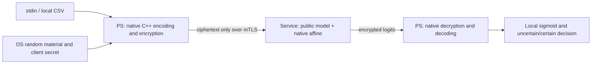

# V4 原生 CKKS 候選 / Native CKKS candidate

這是獨立於已接受 V3 板測基線的候選。C++17 已實作 canonical encoder／decoder、OS 取樣、RNS、KeyGen、Encrypt、Decrypt、CRT、不溢位界線、affine、sigmoid 與分類區間。Python 負責互動輸入、CSV、JSON／HTTP／TLS 與顯示；數學流程呼叫 C++。純 C++ 的 `interactive.cpp` 可獨立完成 CPU 示範。

**English:** This candidate implements the full functional client arithmetic in native C++. It preserves the custom sparse research profile; it is not a production security release or an OpenFHE ciphertext-compatible implementation. New CPU acceptance does not inherit the frozen V3 board acceptance. Board operations are exclusively operator-run.

## 1. 檔案與架構 / Files and architecture

| 檔案 / File | 實際責任 / Responsibility |
|---|---|
| `core.hpp`／`core.cpp` | FFT、ties-to-even、RNS、89-bit CRT、Linux getrandom、CPU NTT／乘法、KeyGen／Encrypt／Decrypt、affine、數值界線、sigmoid；已有 descriptor 時的 DMA adapter |
| `c_api.cpp` | 固定長度 C ABI、錯誤轉換、opaque context、16-byte signed-wide representation |
| `native_api.py` | ctypes 薄層；數學在 C++；context manager 釋放 native context |
| `python_baseline.py` | 同樣預計算 plans、公鑰轉換重用與 affine 排程的純 Python 對照；不含 DMA／TLS／golden oracle |
| `benchmark.py` | 相同輸入、交錯順序、warm-up、P50／P95 與全部原始 latency；單核心、三 limb 平行及全槽位 |
| `net_config.py`／`transport.py` | 可配置 HTTPS origin／port；CA／hostname 驗證、certificate pin、Bearer；設定 `mtls=true` 時要求 client certificate |
| `protocol.py` | 嚴格 V4 密文封包；任意 request ID、public model ID、profile／scale、canonical residues、request-response 綁定 |
| `model.py`／`model.example.json` | 公開 affine 模型、模型 SHA、輸入範圍與容許誤差；沒有 private fixtures |
| `pc_server.py` | 有界 worker／replay ledger；僅接收密文；事件紀錄不保存明文、私鑰、Bearer 或封包 body |
| `dynamic_client.py` | 本機 stdin／CSV 私密輸入；公鑰在 session 中重用，每批重新取樣；解密結果只在本機顯示 |
| `selftest.cpp`／`tests/` | 純 C++ 全複數槽位、整數雜訊消去、CRT、scalar affine、協定負向測試、千組獨立 dense oracle、loopback mTLS |



目前命令列預設 **CPU backend**，不開啟 `/dev/edgefhe_rns3_n4096_dma`。C++ API 可接收已開啟的 board FD，但該路徑尚未對 V4 做板測；此版未提供跳過 live identity gate 的自動硬體部署。網路測試只證明本機 process／API 邊界，不能當作兩台機器的實體隔離證據。

## 2. 數學契約 / Mathematical contract

固定 `N=4096`，slots=2048，`q=(998244353,1004535809,469762049)`，`Q=471064322751194440790966273`，ring 為 `Z_Q[X]/(X^N+1)`，所以 `X^N=-1`。NTT roots 為 `psi=(350007156,2062645,62025685)`。所有 API／wire residues 均為 **ordinary domain、coefficient domain、natural coefficient order**；NTT-domain 值不可混用。Wire 是 `[polynomial][limb][coefficient] uint32 little-endian`，與 DMA 的 `[coefficient][limb0,limb1,limb2,pad0]` 不同。

V4 使用 `Δ=2^29`、affine output scale `Δ²=2^58`。**V3 仍為 `2^24`／`2^48`。** V4 profile ID 為 `edgefhe-functional-sparse-n4096-v4-s29`；封包拒絕錯誤 profile 或 scale。提高 scale 不修改 PL primes／NTT，仍須驗證各輸入範圍的整數界線。

1. **Embedding / `encode`**：設定 `v[k]=slot[k]`、`v[N-1-k]=conj(slot[k])`，其餘補零。令 `ζ=exp(iπ/N)`，`m[j]=round_even(real(FFT(v)[j]/N/ζ^j)·Δ)`。係數限於 int64 可表示範圍，拒絕非有限值、超過 2048 個槽位或槽位 magnitude>16。
2. **Decode / `decode`**：`N·IFFT((coefficient[j]/scale)·ζ^j)`，取前 N/2 槽位。係數輸入為 signed 128-bit；CRT 值不截斷為 int64。量化誤差界線為 `N/(2·scale)`，另保留 `1e-8` 的浮點驗證 allowance；不是形式化 IEEE 證明。
3. **Sampling / `sample_material`**：secret s 與各 encryption mask u 都有 64 個不同非零位置，e／e0／e1 有 16 個，值為 ±1。a 各 limb 在 `[0,q)` 均勻取樣。Linux `getrandom()`，處理 short reads／EINTR；rejection sampling 避免 modulo bias；失敗停止，沒有 time seed、rand() 或固定 seed fallback。這仍是自訂稀疏功能分布，**不宣稱任何安全位元數**。
4. **KeyGen / `keygen`**：`b=-a·s+e mod Q`，公鑰為 `(b,a)`；secret 僅留在 client。公鑰可重用，u／e0／e1 每批必須更新。
5. **Encrypt / `encrypt`**：每特徵 `c0=b·u+e0+m`、`c1=a·u+e1 mod Q`。四特徵分成四份密文，每個特徵可裝 1～2048 筆記錄；同一槽位 index 對應同一筆記錄。
6. **Decrypt / `decrypt`**：`CRT_center(c0+c1·s)=m+e·u+e0+e1·s`，前提是沒有 centered CRT wrap。`||noise||1≤16·64+16+16·64=2064`。C++ CRT 中間值小於 `3·2^119`，signed 128-bit 足夠；輸出採 `v>Q/2` 時減 Q。
7. **Affine / `affine`**：`W_i=Encode(w_i,Δ)`、`B=Encode(bias,Δ²)`，`C0'=B+Σc0_i·W_i`、`C1'=Σc1_i·W_i`。若所有槽位使用相同 w_i，W_i 是常數多項式：只需逐係數 scalar multiply-add，為 **O(N)**。一般 polynomial weights 才走融合 NTT 路徑。兩條路徑都保留 exact coefficient checks。
8. **No-wrap / `no_wrap_bound`**：`U=Σ(||m_i||1+2064)·||W_i||1+||B||∞`，要求 `2U<Q`。C++ 在乘法前用 `(floor(Q/2)-bound)/operand` 檢查，避免 bound 自己先溢位。收到結果後再檢查所有 centered coefficients magnitude≤U。這不證明惡意 cloud 正確執行指定模型。
9. **Numerical bound / `affine_error_bound`**：`E_x=N/(2Δ)+2064/Δ+g`、`E_w=N/(2Δ)+g`、`E_b=N/(2Δ²)+g`，`E_aff=Σ(|w_i|E_x+input_abs_max·E_w+E_xE_w)+E_b+g`，`g=1e-8`。模型若超出其公開 `max_logit_error`，立即拒絕。範例 `|x|≤16`、weights `[1.1,-.7,.9,.4]` 的 bound 約 `2.69e-4<5e-4`，實際精確數字見接受報告。
10. **Decision / `sigmoid`／`classify`**：sigmoid 採穩定正負分支，機率誤差≤`E_aff/4+g`。區間 `[logit-E_aff,logit+E_aff]` 跨 0 時回傳 `class=None`，不得硬判。非線性留在 client；不做 cloud sigmoid、rotation、rescale、relinearization 或 bootstrapping。

## 3. 已實作的最佳化 / Implemented optimizations

CPU NTT 預計算 roots、twist 與常數 Shoup factors，將 INTT normalization 合併 untwist。Shoup 使用 `w'=floor(w·2^32/q)`，`r=xw-floor(xw'/2^32)q`，在 `0≤x,w<q<2^30` 下 `0≤r<2q`，最多減 q 一次。

一般 point product 使用 CPU Barrett：`μ=floor(2^64/q)`、`t=ab`、`k=floor(tμ/2^64)`、`r=t-kq`；`t<q²<2^60`，最多一次修正。這是 **PS C++／128-bit CPU arithmetic**；PL 仍是已接受的 Montgomery HLS。不要把 PS 程式加入 HLS project。

Encrypt 在一批四特徵中重用 a／b 的 NTT，各 u 的轉換供兩個 ciphertext components 共用。一般 affine 先在 evaluation domain 合併乘積，只做兩次 INTT；相同槽位模型改走 O(N) scalar fast path。可選 `workers=1` 或 `3`，三個 RNS limb 分工；不代表三個 DMA 能同時執行。CPU 仍有可改進的 memory／FFI 成本，結果不主張優於所有 OpenFHE 實作。

## 4. 立即可重現的本機工作 / Local reproduction

需要 Linux GCC／Clang C++17、CMake≥3.20、Python≥3.10、pthread；不需要 Boost、pip 套件、kernel headers 或 FPGA。Loopback mTLS 測試另需 `openssl` executable。從 repository root：

```bash
python3 tools/verify_repository.py
cmake -S software/native_ckks -B build/native-v4 -DCMAKE_BUILD_TYPE=Release
cmake --build build/native-v4 -j 4
ctest --test-dir build/native-v4 --output-on-failure
python3 software/native_ckks/tests/validate_native.py --build build/native-v4
python3 software/native_ckks/benchmark.py --library build/native-v4/libedgefhe_native.so --output local/cpu_benchmark_01.json --rounds 30 --warmups 3
python3 software/native_ckks/tests/local_network_test.py --library build/native-v4/libedgefhe_native.so --output local/tls_qa_01
./build/native-v4/edgefhe_native_demo
```

最後一行從 stdin 讀取四個值，不放在 command-line arguments。`native_demo` 是本機 CPU math 示範；`local_network_test.py` 是 loopback TLS 介面測試，產生的短效測試憑證／token 都在 private output 中，不可提交 Git。

預期 explicit markers：`NATIVE_CPP_SELFTEST_PASS`、`V4_PROTOCOL_OFFLINE_NEGATIVE_PASS`、`NATIVE_LOCAL_MATHEMATICAL_ACCEPTANCE_PASS`、`PYTHON_CPP_PAIRED_CPU_BENCHMARK_PASS`、`DYNAMIC_PRIVATE_INPUT_LOCAL_MTLS_PASS`。僅 exit=0 不算接受。

## 5. 動態兩機部署前的邊界 / Before two-machine deployment

實際 client 支援：

```bash
python3 software/native_ckks/dynamic_client.py --config local/client_config.json --server-cert local/server_ca.pem --private-dir local/client --library build/native-v4/libedgefhe_native.so --model software/native_ckks/model.example.json
```

批次資料可加 `--input-csv local/private_input.csv`，每列四個已標準化 real features，最多 2048 列。Client 不把 records／secret／decrypted output 送給 server。輸入檔、結果與憑證須依團隊存取規則放在 private location。

服務：

```bash
python3 software/native_ckks/pc_server.py --config local/server_config.json --private-dir local/server --model software/native_ckks/model.example.json --library build/native-v4/libedgefhe_native.so --audit local/server_audit_01.jsonl --bind 0.0.0.0
```

config 需包含 `protocol=edgefhe-dynamic-affine-tls-v4`、HTTPS server URL、server ID、fresh 64-hex token、server DER certificate SHA、boolean `mtls`，以及適用的 client certificate／key／CA 相對名稱。Port 取自 URL，未指定才用 HTTPS 443。**正式測試應使用 `mtls=true`，server certificate SAN 要包含實際 IP／DNS；loopback QA 憑證不能拿來部署。** Server private directory 只給 server key/cert 與 client CA；client secret key 不在 server。Client private directory 只放 client TLS key/cert。TLS key 與 CKKS secret 是不同金鑰。

設定與憑證由操作者準備，避免共享私鑰或不經驗證交換 certificate pin。本版未把任何 token／private key 寫進 repo，也未以工具連線至 KV260。具體角色與驗收見 [V4 手冊](../../docs/NATIVE_V4.md) 與 [威脅模型](../../docs/NATIVE_V4.md)。

## 6. 接受狀態與限制 / Acceptance and limits

目前原生功能、千組不同 dense、全複數槽位、loopback 動態批次／mTLS、協定負向測試及 Python／C++ CPU 比較已做本機接受；原始結果見 [candidate acceptance](../../release/NATIVE_CANDIDATE.json) 及 [實驗分析](../../docs/NATIVE_V4.md)。標準 OpenFHE 完整 client 的獨立 CPU baseline 在 [validation/openfhe_client](../../validation/openfhe_client/CMakeLists.txt)，使用 library 的標準 sampler，primes／embedding／ciphertext 格式與本候選不同。

尚未完成：V4 aarch64 compiler／ARM benchmarks、native→PL exact parity與兩機私密展示、標準安全 profile 與固定 PL 的相容性、constant-time／side-channel／memory zeroization 稽核、實體 reset／fatal recovery、真實模型／資料集與正式 release。重複 V3 的 6 小時穩定測試，不能替 V4 的新來源背書。詳見 [修正審查](../../docs/NATIVE_V4.md)。

References: [Linux getrandom](https://man7.org/linux/man-pages/man2/getrandom.2.html), [DMAengine client API](https://docs.kernel.org/driver-api/dmaengine/client.html), [OpenFHE CKKS examples](https://github.com/openfheorg/openfhe-development/blob/main/src/pke/examples/simple-real-numbers.cpp).
