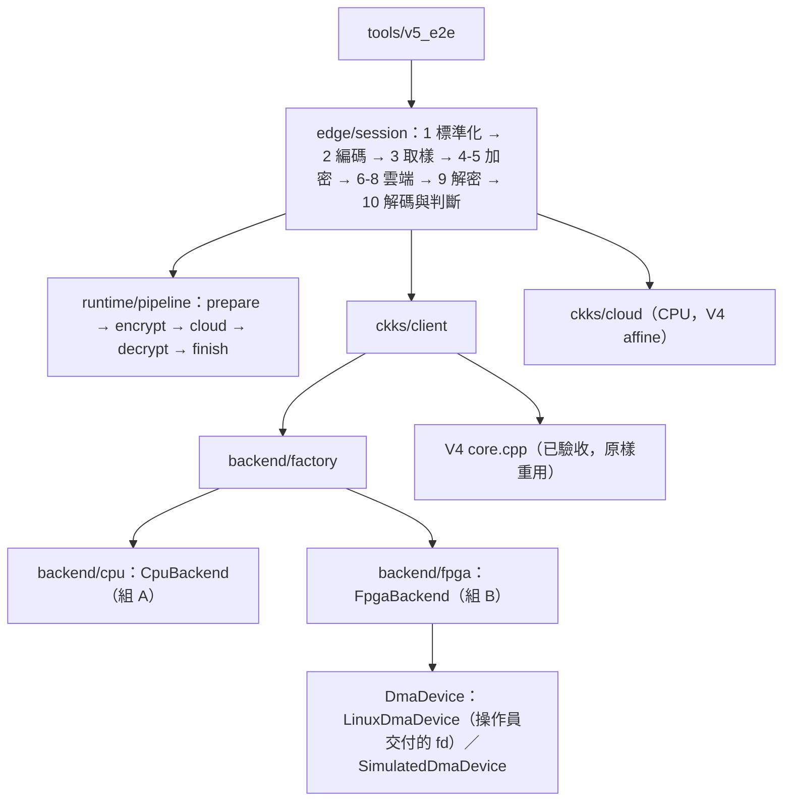

# V5：模組化後端、量測平台與兩組對照 / Backends, measurement harness and the A/B comparison

**狀態：主機檢查通過（x86_64 WSL：最佳化版、ASan/UBSan、TSan、C ABI 與 V4 比對、127.0.0.1 雙向 TLS 演練）；2026-10-14 第一次上 KV260：板上 GCC 11 編譯、24 項單元測試通過，實板 CPU ↔ FPGA 一致性 `V5_PARITY_PASS device=linux-dma`，階段 2 完整 A/B 量測 `V5_STAGE2_COMPLETE`（六種設定逐位元相同）；同日以 `--encode-workers 4` 再測通過（板上 25 項單元測試），並拆開每次 FPGA 呼叫的時間。** 收據見 [local_acceptance.json](../../release/native_v5/local_acceptance.json)；研究設計與實板結果見 [兩組對照](../../docs/COMPARISON.md)，上板步驟見 [上板指南](../../docs/BOARD_GUIDE.md)。

V5 不改任何數學：原封不動重用已驗收的 V4 [core.cpp](../native_ckks/core.cpp)（編碼、取樣、RNS、CRT、NTT、界線檢查），只重新安排「多項式乘法由誰算、怎麼排程、怎麼量」。每個乘積、每把金鑰、每份密文都與 V4 `Engine` 逐位元相同，由測試保證。

**English:** V5 reuses the accepted V4 arithmetic unchanged. It adds a backend seam (CPU = group A, FPGA = group B), a persistent thread pool, double-buffered DMA packing, an N-stage bounded pipeline, the edge flow as named steps 1–10 with per-step timing, a single end-to-end harness for both groups (correctness / latency / throughput, CPU time, hwmon power), a V4-compatible C ABI for the two-machine demo, and the board runners. Host-tested only.

## 1. 資料夾 / Layout

```
software/native_v5/
  common/       json（嚴格讀寫）、sha256、platform（綁核、CPU 時間、cpufreq、hwmon 功耗）、stats
  runtime/      thread_pool（持久 fork-join、SerialWorker）、pipeline（N 段有界管線 run_stages）
  backend/      backend（PolyBackend 介面）、factory（cpu-wN／fpga-serial／fpga-overlap）
    cpu/        CpuBackend ................................................ 組 A
    fpga/       FpgaBackend、DmaDevice（Linux／Simulated）、dma_abi .......... 組 B
  ckks/         client（keygen／encrypt／decrypt）、model（模型與前處理）、cloud（雲端仿射）
  edge/         dataset（CSV）、session（步驟 1–10）、runner（批次、摘要、正確性）、qa_random
  tools/        v5_e2e（兩組對照主工具）、v5_parity（CPU↔FPGA 一致性）、v5_bench（熱路徑微量測）
  capi/         c_api.cpp：與 V4 相同的 ef_* ABI，後端換成 V5（兩機展示用）
  python/       edge_client.py（板端 client）、make_demo_tls.py（兩機 mTLS 憑證）
  tests/        v5_tests.cpp（25 項）、capi_test.py、two_machine_loopback.py、data/（合成測試資料）
```



| 檔案 | 責任 |
|---|---|
| `backend/backend.hpp` | `MulJob`、`PolyBackend::multiply_batch`：輸出不得與輸入或彼此重疊；一次一批 |
| `backend/factory.cpp` | 後端名稱 → 物件。新增後端時這裡是其中一處，其他要改的地方見[兩組對照](../../docs/COMPARISON.md)的「新增一個後端」 |
| `backend/cpu/cpu_backend.cpp` | 共用運算元每個分量只做一次 NTT（加密批次 14 次轉換而非 24 次），(分量×運算元) 工作切分，4 核可用滿 |
| `backend/fpga/fpga_backend.cpp` | 分量優先 ↔ 係數優先的轉置、填充與 canonical 檢查、雙緩衝重疊、pack／device／unpack 計時 |
| `backend/fpga/device.cpp` | `LinuxDmaDevice`（ioctl，不開啟、不重試）；`SimulatedDmaDevice`（與驅動相同的請求檢查＋op2，可注入故障） |
| `edge/session.cpp` | 步驟 1–10，每步計時；加密與解密共用後端，用鎖保證同時只有一批在後端 |
| `edge/runner.cpp` | 串行或管線執行多批；CPU 時間、功耗；密文與解密結果 SHA-256；與明文比對、AUC |
| `edge/qa_random.cpp` | 公開種子的固定金鑰與隨機數，**只用於測試**（任何人都能重算私鑰） |
| `runtime/pipeline.hpp` | `run_stages`：capacity 0 是串行對照；≥1 時每段一個執行緒、有界佇列、保持順序、例外即取消 |

## 2. 工具 / Tools

| 工具 | 用途 | 例子 |
|---|---|---|
| `v5_e2e` | 兩組對照主工具：`correctness`、`latency`、`throughput` 三種模式，輸出 JSON；`--encode-workers 1..4` 讓步驟 ② 的四個特徵平行編碼（兩組共用、結果逐位元相同） | 見下方 |
| `v5_parity` | CPU ↔ FPGA 逐係數一致性＋一次完整 client 回合 | `./v5_parity --fd 3 --cases 64` |
| `v5_bench` | 只量熱路徑（四特徵加密＋一次解密） | `./v5_bench --rounds 30` |
| `libedgefhe_v5_capi.so` | V4 相同 ABI；`native_api.Native(lib, workers, fd)` 直接可用（fd −2 = 模擬裝置） | 兩機展示 |
| `python/edge_client.py` | 板端 client：讀 CSV、標準化、加密、經 mTLS 送雲端、解密、彙整 | 見[上板指南](../../docs/BOARD_GUIDE.md)階段 3 |

```bash
build/v5/v5_e2e --data data/cdc_diabetes/splits/test.csv --model training/outputs/model.json \
    --preprocess training/outputs/edge_preprocess.json --output result.json \
    --backends cpu-w1,cpu-w4,fpga-overlap [--fd 3] --cpus 0-3
```

板上請用 [run_comparison.py](../../tools/run_comparison.py)（編譯、自檢、量測、報表一次完成），再用 [compare_results.py](../../tools/compare_results.py) 合併多份結果。

## 3. 保證與邊界 / Invariants

- **算術不變**：keygen、加密、雲端、解密、每個乘積都與 V4 `Engine` 逐位元相同（`client_matches_v4_engine`、`session_matches_v4_engine`、`capi_test.py` 對 V4 函式庫）。
- **兩組互為標準答案**：`v5_e2e --modes correctness` 讓所有後端用同一把金鑰與同一組隨機數，密文與解密結果的 SHA-256 必須完全相同。
- **板子操作由操作員負責**：V5 不開啟、不重置、不重試裝置，只接受操作員在 live identity gates 之後交付的 fd。`run_comparison.py` 只透過 `/proc/self/fd` 確認 fd 指向正確裝置。DMA 失敗就停止。
- **一次只有一筆在途**：雙緩衝與管線只重疊 CPU 端工作；驅動仍一次處理一個請求。
- **模擬裝置不偽造**：只模擬 op2；op0／op1 回傳 `-EOPNOTSUPP`。模擬裝置的時間是 CPU 時間，結果檔標記 `device_times_are_fpga: false`。
- **安全 profile 不變**：稀疏功能取樣器，不宣稱任何安全位元數。

## 4. 建置與檢查 / Build and checks

```bash
# 整個 repo（CI 也跑這個）：V4＋V5 共 9 個 CTest
cmake -S . -B build/native -DCMAKE_BUILD_TYPE=Release
cmake --build build/native --parallel 4
ctest --test-dir build/native --output-on-failure

# 不需要 CMake 的發行版建置（板上或電腦）
python3 tools/v5_sources.py --output build/v5

# 全部主機檢查：最佳化版＋ASan/UBSan＋TSan、C ABI、mTLS 迴路；全部通過才更新收據
python3 tools/run_v5_checks.py --output build/v5_checks/<新資料夾> \
    --receipt release/native_v5/local_acceptance.json
```

修改 `software/native_v5` 下任何程式、腳本或測試資料（`.md` 除外），或 `tools/v5_sources.py`、`tools/run_v5_checks.py` 之後，都要重跑上面最後一行，再執行 `tools/update_manifest.py` 與 `tools/verify_repository.py`。收據和檔案對不上時，`verify_repository.py` 會失敗並提示重跑。

## 5. 兩組怎麼用 / For the two groups

- **組 A（純軟體平行）**：改 `backend/cpu/`。例如 NEON 向量化、記憶體排列、工作切分、把多批一起排程。新寫法可以是新的後端類別，再到 `factory.cpp` 註冊名稱（例如 `cpu-neon-w4`）。
- **組 B（軟硬體協同）**：改 `backend/fpga/`。例如更深的雙緩衝、把部分乘積分給 CPU 的混合後端、或將來新的 HLS 運算（例如一次完成整段加密）。新 HLS 運算＝新 bitstream＝新的板測驗收。
- **共用部分**（`common/`、`runtime/`、`ckks/`、`edge/`、`tools/v5_e2e.cpp`）兩組協議後才改，因為它們定義了「同計時範圍」。

## 6. 實板結果 / Board results

2026-10-14 在 KV260 量過（CDC 38,052 筆）：步驟 ② 平行編碼後，單批延遲 cpu-w4 37.4 ms、fpga-overlap 69.9 ms；每次 FPGA 呼叫 4.7 ms 裡 DMA＋PL 只有 0.56 ms，3.59 ms 是凍結的 V3 驅動在不經快取的緩衝區逐筆檢查係數（[trace_dma_call.py](../../tools/trace_dma_call.py)）。完整數字與解讀見 [兩組對照](../../docs/COMPARISON.md)。電腦上的「FPGA」列是模擬裝置，時間是 CPU 時間，不能當 FPGA 數據。

## 7. 尚未完成 / Not done

- 實體兩機展示（階段 3）只在 127.0.0.1 演練過；板子還沒有網路。
- 管線已在真實 DMA 上跑完階段 2，但還沒做 [架構文件](../../docs/ARCHITECTURE.md) P1 要求的長時間 soak、回壓與故障測試。
- 每次 FPGA 呼叫多出的 4.1 ms 已拆開：幾乎都是凍結的 V3 驅動在不經快取的緩衝區上讀取。要省下這段需要另立新版驅動，V5 這邊不用改。
