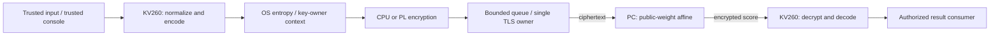
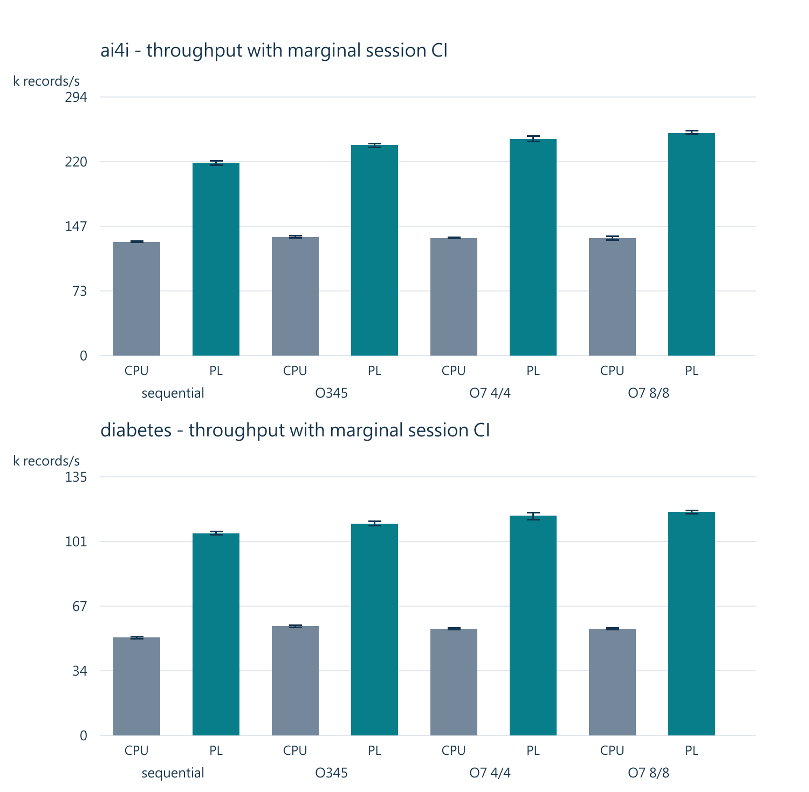
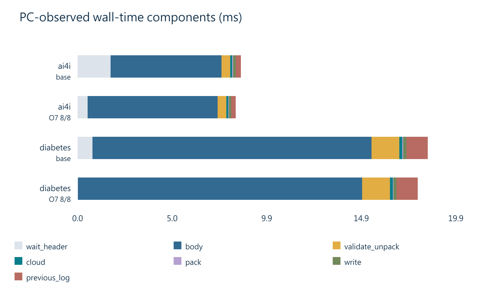
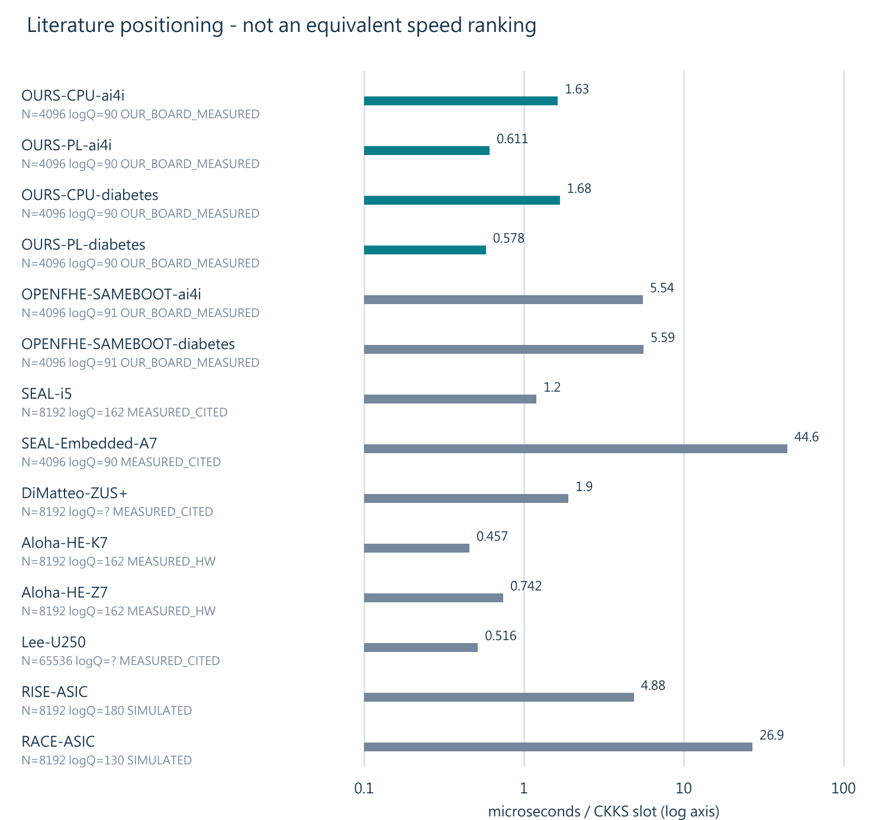
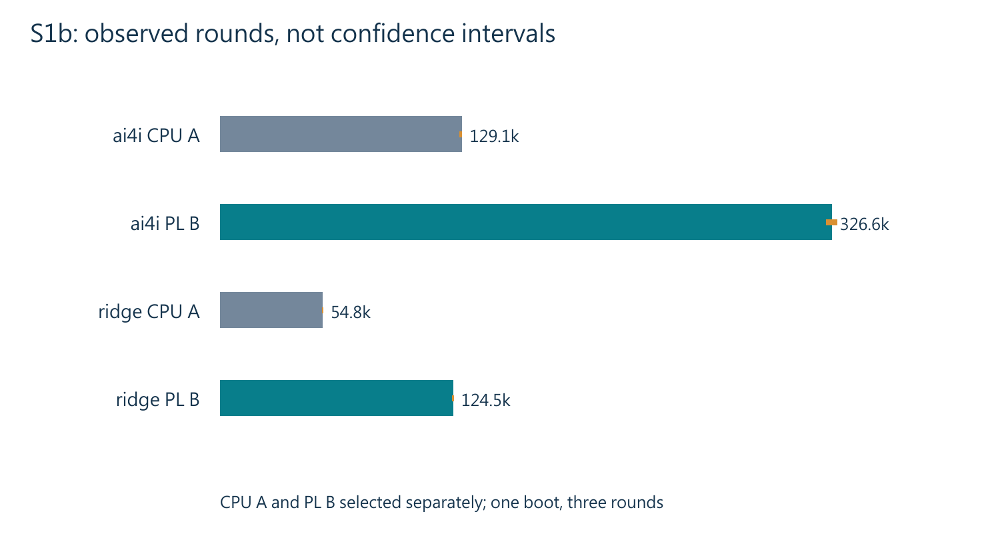

# EdgeFHE 邊緣端 CKKS 加速與私密 affine 分析

教授進度報告與來源發布候選。所有量測以各自來源及版本為準；F4／F5由使用者審核並免另簽；權利人授權待確認。

## 1. 問題、應用與研究定位

本研究探討來源端保有資料與私鑰、卻需使用外部數值服務時的成本。若公開小型模型能完全在本地執行，應保留本地推論作替代方案；不能只因資料敏感就推論必須雲端 HE。糖尿病進展與工業健康評分用於研究展示，不代表診斷、腎病變預測或已獲企業採購。

CKKS 原始工作說明近似數值運算；Full-RNS 方法與客戶端硬體工作提供算術與分工參考。Amdahl 與 Roofline 支持從整體流程、資料搬移與可重疊工作分析，而非僅引用核心峰值。文獻為定位，不能把不同方案、參數與平台的倍數拼成我方成果。

## 2. 系統與數學設計

owner context 持有金鑰、預先轉換的頻譜與持久 workers；I/O 執行緒唯一持有 TLS 物件；解密工作使用獨立可變狀態。queue 有界並施加背壓，禁止 timeout 後無條件重送。PS 完成正規化、編解碼與熵來源；PL 快取公鑰並執行分組 ENC／PAIR；PC 僅作公開權重 affine。

N=4096; slots=2048; q=998244353, 1004535809, 469762049; scale=1073741824; sigma=4.5

在 R_Q=Z_Q[X]/(X^N+1) 中，b=-a*s+e；c0=b*u+e0+m，c1=a*u+e1，因此 c0+c1*s=m+e*u+e0+e1*s。相同整數雜訊一致映射至各 RNS limb。NTT、排列、正規殘值與 Montgomery 表示須匹配。

現有 affine 採定點整數權重 W，雲端係數級累加 sum(Wj*Cj)，偏置只加入 c0 的常數項。輸入 scale 與權重 scale 相乘後由擁有者解碼時還原；此受限路徑不需要一般多層 CKKS 的 rescale。不能據此宣稱支援任意深度。

標準化 z=(x-mu)/s 在來源端完成。每個特徵使用一個密文的各槽放置不同資料列；模型的明文權重以固定點整數表示。雲端不解密結果；擁有者移除尺度、解碼後才做 sigmoid 或判斷。所有非線性後處理與分類邊界須在應用契約中明列。

可信任的資料擁有者端持鑰。雲端計算元件不取得 HE 私鑰；若 PC 同時承載輸入主控台，該主控台必須列為可信任元件，不能說整台 PC 看不到輸入。HE 不提供惡意雲端的結果正確性證明，也不自動保護側信道、端點記憶體、查詢時序、輸出推論與線性模型擷取。公開 oracle 只用於驗證模式。

## 3. 正確性、精度與安全界線

整數環運算要求逐係數一致；NTT 根、負循環卷積、頻譜排列、Montgomery 轉換和 CRT 有號還原須逐項匹配。CKKS 解碼另以數值誤差驗收，不能將浮點近似與整數殘值錯誤混為一談。

獨立 schoolbook 驗證涵蓋稠密公鑰多項式乘三元 u；ENC 框再與規格模型核對。它不是所有可能多項式、所有硬體故障的完整證明。不同輸入分布、金鑰和模型的誤差窗口要分開記載。

加密誤差包含 e*u、e0、e1*s，並經 affine 權重放大。總誤差也受輸入編碼、權重量化、偏置量化與解碼捨入影響；必須核對模數回捲與尺度。每金鑰精度界為研究分析，分布檢定與測試通過不代替安全證明。

安全參數評估使用稠密三元私鑰與指定 Gaussian 分布，落在引用標準表的研究參數範圍。這不是完整 lattice-estimator 重現、安全認證或側信道證明。owner.cpp 的顯式清除與其巢狀緩衝生命週期仍需專項稽核；發布此限制並不等於已修復。

## 4. 效能、能效與參考基準

| Model | Latency CPU/PL | Throughput PL/CPU | Evidence |
|---|---:|---:|---|
| ai4i | 1.600 [1.571, 1.626] | 1.641 [1.635, 1.646] | E-WIRED |
| diabetes | 1.811 [1.792, 1.829] | 2.022 [2.013, 2.030] | E-WIRED |

| Workload | OpenFHE prepare ms | CPU3 prepare ms | PL prepare ms | OpenFHE/PL |
|---|---:|---:|---:|---:|
| ai4i/1 | 44.893 | 13.387 | 4.912 | 9.139 [9.105, 9.173] |
| ai4i/2048 | 45.405 | 13.354 | 5.007 | 9.069 [9.051, 9.084] |
| diabetes/1 | 114.045 | 32.516 | 10.667 | 10.691 [10.667, 10.716] |
| diabetes/2048 | 114.543 | 34.428 | 11.848 | 9.668 [9.609, 9.720] |

| Encryption feature count | PL/CPU ratio, CI | Evidence |
|---|---:|---|
| F=4 | 4.186 [4.173, 4.199] | E-SUITE |
| F=10 | 5.375 [5.337, 5.422] | E-SUITE |

In-process sustained ai4i PL records/s: 832396 [831638, 833155] (E-SUITE; no network, not E2E).

Energy PL/CPU records/J: 4.274 [4.263, 4.286] (INA260 SOM rail only).

Soak E-WIRED: active_h=6.0018; requests=1,650,251; records=3,379,714,048; device_calls=2,726,453; max_error=0.00047366.

歷史O7探索設定見下表（最新S1b結果另列）；單位 records/s，每個中括號為各自 CI。

| Model/backend | Sequential | O345 | O7 4/4 | O7 8/8 |
|---|---:|---:|---:|---:|
| ai4i/cpu | 129268 [128861, 129904] | 134898 [133945, 136102] | 133665 [133390, 134151] | 133457 [131440, 135278] |
| ai4i/pl | 219145 [216159, 221159] | 238990 [236380, 240980] | 245972 [242973, 249169] | 252976 [251616, 255397] |
| diabetes/cpu | 51253 [50457, 51653] | 56992 [56458, 57547] | 55675 [55203, 56173] | 55623 [55130, 56093] |
| diabetes/pl | 105566 [104676, 106472] | 110498 [109676, 111816] | 114661 [112742, 116280] | 116745 [115742, 117384] |

同一模型中，CPU 與 PL 共用傳輸、模型與輸出處理，能效則只包含感測器所覆蓋的 SOM 電源軌。B1 的 OpenFHE 不使用完全相同的 Q，且準備時間包含不同函式庫策略，應稱工作負載與安全參數級別對照。跨平台每元素時間亦不是等效平台排名。

## 5. 最佳化歷程與量測方法

O1 單純加深管線未帶來可接受增益。O3 全雙工單獨使用在部分工作負載下降；O4 把請求雜湊移出準備路徑，收益依模型而異；O5 獨立解密對 PL 的收益小，部分設定略負。

| Model / backend / step | Throughput over prior step, CI |
|---|---:|
| ai4i / cpu / O3v2 | 0.926 [0.919, 0.934] |
| ai4i / cpu / O3v2+O4 | 1.094 [1.060, 1.123] |
| ai4i / cpu / O3v2+O4+O5 | 1.026 [1.000, 1.060] |
| ai4i / pl / O3v2 | 0.959 [0.938, 0.979] |
| ai4i / pl / O3v2+O4 | 1.159 [1.139, 1.185] |
| ai4i / pl / O3v2+O4+O5 | 0.995 [0.989, 0.998] |
| diabetes / cpu / O3v2 | 0.944 [0.915, 0.980] |
| diabetes / cpu / O3v2+O4 | 1.114 [1.071, 1.159] |
| diabetes / cpu / O3v2+O4+O5 | 1.040 [1.014, 1.069] |
| diabetes / pl / O3v2 | 1.009 [0.900, 1.085] |
| diabetes / pl / O3v2+O4 | 1.021 [0.949, 1.145] |
| diabetes / pl / O3v2+O4+O5 | 1.010 [1.008, 1.012] |

O7 限制同時在線數，增加吞吐時也增加排隊延遲。應分開提供單筆延遲模式與批次吞吐模式。

量測須保存各 session 原始結果、暖機、順序、來源與環境。吞吐以窗口完成量並納入 drain，不以單筆延遲倒數替代。重抽樣單位為 session，禁止把同一 session 內大量樣本當成獨立實驗。短期 O7 的 session 數較少，不能當成跨日期跨板的廣泛保證。

伺服器的 body 牆鐘包含來源端 TLS 送出、網路與 PC TLS 接收。即使 busy 比例很高，也不足以歸因到 PC CPU。S0／S0b／S1a／S1b已完成分離量測及配置比較；後續仍須拆解準備成本，並以新舊候選交錯 A/B 及匹配設定比較；不得用假說覆寫目前結論。

## 6. 可靠性、故障處理與重現

正式有線基線的長測統計如效能表所示。其 IRQ／裝置呼叫與兩端 digest 經原件審查對帳；這不等於後續所有候選都已完成相同長測。

C01 覆蓋指定惡意框、租約、憑證釘選錯配、連線故障與程序終止等案例。故障時保留證據、不自動重送；未證明完整 quiescence 時停止並隔離。重新載入後的恢復流程與在途 DMA 的無條件安全復原是不同主張。

發布重現分兩層：來源乾淨建置、CPU/spec 與本機 TLS 功能；以及外部受控封存的獨立分析重跑。這些都不會重新量測實板效能。AI 的乾淨副本演練亦不能代替第三人執行紀錄。

## 7. 限制、產品假設與後續計畫

只涵蓋單擁有者 affine；排除 PL bootstrapping；未提供一般 rotation、relinearization、多方金鑰或完整密文深度模型。數學 M1 的獨立 schoolbook 範圍是稠密乘三元，不能擴張為任意稠密乘稠密。探索性症狀模型有誤差例外。正式有線基線及O7各有自己的六小時證據；S1b-B僅有短期A/B，不繼承O7長測PASS。尚無正式側信道認證或完整敏感 scratch 清除證明；無臨床與採購效益背書。

F4／F5由使用者自行審核並免除另簽；權利人授權待確認。S已授權且O7長測、S0至S1b已接受；下一步範圍仍須依T0結果選定，T3須明確同意。

雙板、多方金鑰及更深模型為獨立研究支線，涉及新的參數、安全與工作負載驗收。商業價值需從真正委外需求、替代方案與總成本驗證；公開資料集與加速倍數都不能單獨證明市場。

## 附錄：證據與參考文獻

| Evidence ID | SHA-256 | Scope |
|---|---|---|
| E1 E-WIRED | 8e80dd3c68c2f107c08dd79028b4857cc8d4bf53e2c82881152a286ba380de07 | 依該審查範圍 |
| E2 E-SUITE | 08a9c9ffe1a12412d5c620d7cf3fcf3a31f200ef40f15c486510d92cd6268ba4 | 依該審查範圍 |
| E3 B1 | 9c304b63c347375a7b99eb1e8b756b0fed62f5c499cfface89ca3cd4b2990146 | 依該審查範圍 |
| E4 live_demo_20261024 | 5acedea408b3af7f139250a1e8338cd9c8035c70d7a49946be84d6debd6daafe | 依該審查範圍 |
| E5 optimization_o7_20261024 | 9bbf4ff0cf70c1f7054006760bb567e864fb4a0c396aae28f6a5ec8d5db7f6c7 | 依該審查範圍 |
| E6 optimization_o3_20261024 | 3c05d8f34a6d458a8d55ee81bac4da24848e71d88f0e4d8f8eaa4ec2e9ac54a1 | 依該審查範圍 |
| E7 reference_points_20261024 | f0cb20da6762686d76c9e6a899af15c0c47d7a0399eabe61b0dd835984b6c758 | 依該審查範圍 |
| E8 security_assessment_20261024 | ebec0a51d0b14d215afa63bedbe639c3a14e567c14eef95ef9ea743bde3f02bd | 依該審查範圍 |

參考文獻：以下為既有知識庫的書目紀錄，文獻結果未在本輪重現；年份、卷頁與 DOI 為書目中繼資料。不同平台僅作定位。

[EF01] Florian Krieger and Florian Hirner and Ahmet Can Mert and Sujoy Sinha Roy. Aloha-HE: A Low-Area Hardware Accelerator for Client-Side Operations in Homomorphic Encryption. DATE 2024. DOI: 10.23919/DATE58400.2024.10546608.

[EF02] Zahra Azad and Guowei Yang and Rashmi Agrawal and Daniel Petrisko and Michael Taylor and Ajay Joshi. RISE: RISC-V SoC for En/Decryption Acceleration on the Edge for Homomorphic Encryption. IEEE Transactions on VLSI Systems 31(10), 1523-1536. DOI: 10.1109/TVLSI.2023.3288754.

[EF04] M. Sadegh Riazi and Kim Laine and Blake Pelton and Wei Dai. HEAX: An Architecture for Computing on Encrypted Data. ASPLOS 2020, 1295-1309. DOI: 10.1145/3373376.3378523.

[EF06] Ahmet Can Mert and Aikata and Sunmin Kwon and Youngsam Shin and Donghoon Yoo and Yongwoo Lee and Sujoy Sinha Roy. Medha: Microcoded Hardware Accelerator for computing on Encrypted Data. IACR TCHES 2023(1), 463-500. DOI: 10.46586/tches.v2023.i1.463-500.

[EF11] Jung Hee Cheon and Andrey Kim and Miran Kim and Yongsoo Song. Homomorphic Encryption for Arithmetic of Approximate Numbers. ASIACRYPT 2017, 409-437. DOI: 10.1007/978-3-319-70694-8_15.

[EF12] Jung Hee Cheon and Kyoohyung Han and Andrey Kim and Miran Kim and Yongsoo Song. A Full RNS Variant of Approximate Homomorphic Encryption. Selected Areas in Cryptography - SAC 2018, 347-368. DOI: 10.1007/978-3-030-10970-7_16.

[EF19] Daniele Micciancio and Michael Walter. Gaussian Sampling over the Integers: Efficient, Generic, Constant-Time. CRYPTO 2017, Part II, 455-485. DOI: 10.1007/978-3-319-63715-0_16.

[EF21] Baiyu Li and Daniele Micciancio. On the Security of Homomorphic Encryption on Approximate Numbers. EUROCRYPT 2021, 648-677. DOI: 10.1007/978-3-030-77870-5_23.

[EF36] Ahmad Al Badawi and Jack Bates and Flavio Bergamaschi and David Bruce Cousins and Saroja Erabelli and Nicholas Genise and Shai Halevi and Hamish Hunt and Andrey Kim and Yongwoo Lee and Zeyu Liu and Daniele Micciancio and Ian Quah and Yuriy Polyakov and Saraswathy R.V. and Kurt Rohloff and Jonathan Saylor and Dmitriy Suponitsky and Matthew Triplett and Vinod Vaikuntanathan and Vincent Zucca. OpenFHE: Open-Source Fully Homomorphic Encryption Library. WAHC 2022, 53-63. DOI: 10.1145/3560827.3563379.

[EF39] Samuel Williams and Andrew Waterman and David Patterson. Roofline: An Insightful Visual Performance Model for Multicore Architectures. Communications of the ACM 52(4), 65-76. DOI: 10.1145/1498765.1498785.

[EF40] Gene M. Amdahl. Validity of the Single Processor Approach to Achieving Large Scale Computing Capabilities. AFIPS Spring Joint Computer Conference 1967, 483-485. DOI: 10.1145/1465482.1465560.

[EF41] Tomas Kalibera and Richard Jones. Rigorous Benchmarking in Reasonable Time. ACM ISMM 2013. DOI: 10.1145/2464157.2464160.

## T0增訂：O7長測、S1b採用與後續範圍

### 已接受的結果與採用範圍

本節使用O7專用長測與S1b獨立審查，補正前版「O7沒有自己的長測」的過時說法。O7長測與S1b綁核是不同組合：**S1b-B尚不能繼承O7六小時接受**。

| Model | PL selected B, records/s | CPU selected A, records/s | PL B/A within S1b |
|---|---:|---:|---:|
| ai4i | 323,475-329,546 | 127,831-129,291 | 1.2565-1.3200 |
| ridge | 123,907-125,034 | 54,568-55,240 | 1.0584-1.0753 |

表中為同一次開機的三輪觀察範圍，不是信賴區間，也不是跨日期保證；B/A是PL新舊配置比較，不是PL/CPU加速比。既有正式有線配對CI表保持原版本與工作量。CPU的綁核候選較慢，因此公平基準維持A；PL採B，並沒有把CPU故意改慢。

產品啟動預設：PL的設定為 `slots 8, duplex 1, hash_io 1, decrypt_thread 1, inflight 8, --io-cpu auto (chose cpu1), --io-isolate 0, --read-every 1 (placement B)`；CPU維持A。未改動已接受C++ client的原生CLI預設，而由新的啟動層補入選項，保留歷史A可重現性。即時展示的單筆serial未取得新的綁核效能證據，不能用批次吞吐代替。

Suite、gateway與命令規劃器都由實際argv生成或核對permit contract。PLACEMENT先於PRIVATE_INPUT綁定；變更I/O參數或私密輸出路徑都必須導致舊permit拒絕。這些啟動層整合只取得本機候選QA，沒有在本輪部署。

| Metric | O7 dedicated soak |
|---|---:|
| Active hours | 6.008374 |
| Requests | 2,014,736 |
| Records | 4,126,179,328 |
| DMA jobs | 3,320,109 |
| TLS connections | 384 |
| Max public error | 0.000509600326 |

長測兩端摘要、DMA與IRQ由獨立審查對帳；長測未取得溫度紀錄，不能用之後S1b溫度回填。S1b的DMA合計 114,592，IRQ終值 6,699,271。參數符合性：OPENFHE_STANDARD_CONFORMANCE_PASS；標準表餘裕：classic 20.39 bits; quantum 12.39 bits。這不是完整安全認證。

| Model | OpenFHE / PL prepare, before | OpenFHE / PL prepare, after |
|---|---:|---:|
| ai4i | 10.554 | 10.449 |
| ridge | 11.646 | 11.639 |

OpenFHE仍為同板相同工作負載、相近安全等級的函式庫參考，精確Q不同，不能稱同參數純硬體加速。

### 已更正的瓶頸歸因

S0b的執行緒核心態不能全歸因系統呼叫。S1a分離量測顯示目前TLS送出成本每MB 6.19 ms；重算網卡軟中斷每MB總流量約 6.56-8.07 ms。S1b把I/O移開網卡軟中斷核心後有收益。依時間組成推論，下一個限制是板端準備與跨執行緒干擾；尚未分離編碼、取樣與每個PL階段，不能逕自判定該改哪個演算法。

### 接下來與人工狀態

使用者已自行審核F4、F5並免除另行簽認；不冒稱第三方重現或教授簽名。權利人授權仍待確認。S階段已有使用者授權，T3私鑰加密與種子展開尚未取得特別同意。T0之後優先提議準備時間剖析與係數打包微基準；jumbo等系統設定由使用者決定及執行。公鑰加密與現有參數在本輪維持不變。

